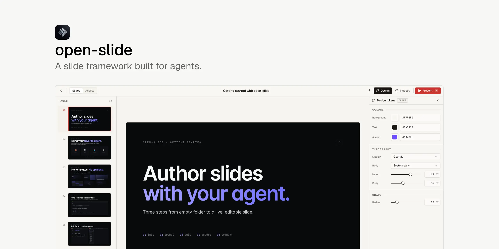

# LemonRiver

**A slide framework built for agents.** Describe the deck in one sentence, review the outline, and let your agent lay it out page by page — then present it or export it.

English · [简体中文](README.zh-CN.md)



Every page renders into a fixed **1920 × 1080** canvas. Pages are ordinary React components, so the agent writes real code rather than filling in a template.

## Highlights

### Start from one sentence

Say what the deck is about — or upload the PDF, Word, Excel or PowerPoint files it should be based on — and LemonRiver drafts an outline for you to review and edit first. It only starts laying out pages once you agree with it. Building happens one page at a time with a team panel showing who is doing what; you can pause, pick up again later, and undo all the way back to the outline. When the numbers in your slides disagree with your files, it stops and asks which one is right.

### Work with the agent you already use

Claude Code, Codex and WorkBuddy all drive the deck from the agent panel in the browser: start a session, watch it work, answer its questions, stop it, leave and come back. The panel follows the model and settings of your own client by default, so it behaves the same as your terminal.

### See the whole deck at once

The story board shows every page grouped into chapters. Drag to reorder, add and delete chapters, fold them away, select several cards at once, filter, and undo. The outline and the board are two views of the same deck — editing one changes the other.

### Fix things in the browser

Switch to comment mode and click any element or drag over a region to leave a note. Comments sit beside the thing they refer to until the agent applies them; one click in the panel applies every pending comment at once. You can also select an element and describe the change in plain words.

### Look after the deck over time

Four themes — follow the system, clean light, night orchard and lime. Deleted decks wait in the trash for 30 days, so a wrong click is never final. New versions of LemonRiver announce themselves in the app and update with one click.

### Present and export

Present full screen with presenter view: current and next page, speaker notes and a timer. Export the deck as a static HTML site, a print-ready PDF, or an editable PowerPoint file whose text stays text.

## Get started

```bash
npx @lemonriver/cli init my-slide --use-pnpm
cd my-slide
pnpm dev
```

`init` installs the dependencies for you — npm, pnpm, yarn and bun are all supported, and `--no-install` skips it. Open the address the dev server prints, press **New deck**, and tell the agent what the deck is about. Everything after that happens in the browser.

## Repo layout

This repo is a pnpm + Turbo monorepo.

| Path | Description |
| --- | --- |
| [packages/core](packages/core) | `@lemonriver/core` — the runtime (home page, deck viewer, story board, present mode, inspector), the Vite plugin, and the `lemonriver` dev/build/preview CLI. |
| [packages/cli](packages/cli) | `@lemonriver/cli` — the `npx @lemonriver/cli init` scaffolder and the workspace template. |
| [apps/demo](apps/demo) | Example workspace that consumes `@lemonriver/core` from this repo. Used to develop the framework. |

## Development

```bash
pnpm install
pnpm dev      # runs the demo against the local @lemonriver/core
pnpm build    # builds all packages
pnpm check    # lints and formats via biome
pnpm test     # runs vitest
```

## Relationship to open-slide

LemonRiver is a fork of [open-slide](https://github.com/1weiho/open-slide) and tracks it as `upstream`. Workspaces written against the pre-rename package name and config file keep working unchanged.

## License

MIT. The original copyright notice is retained in [LICENSE](LICENSE).
